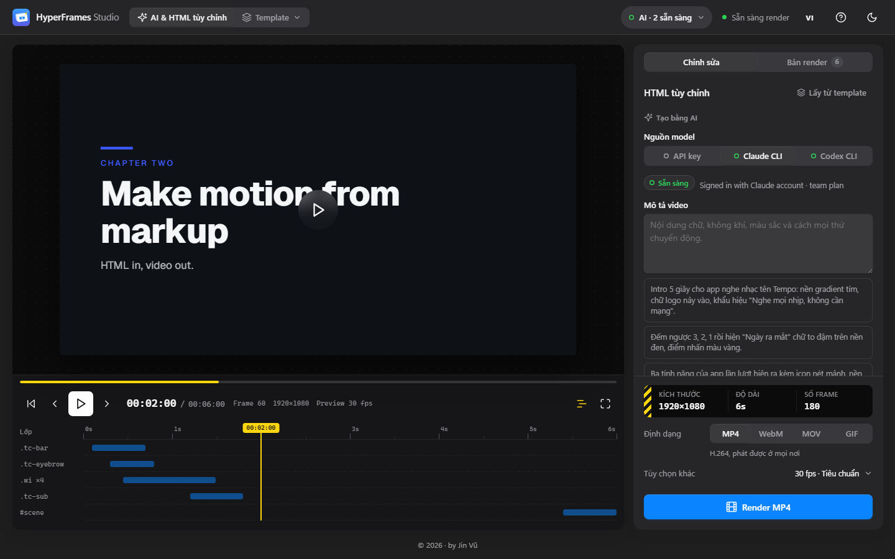
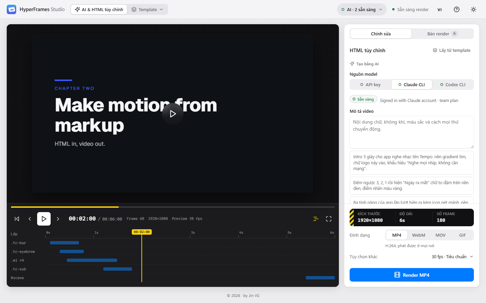
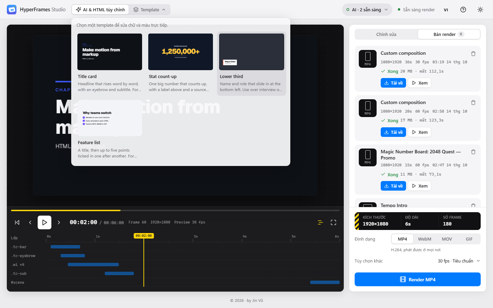
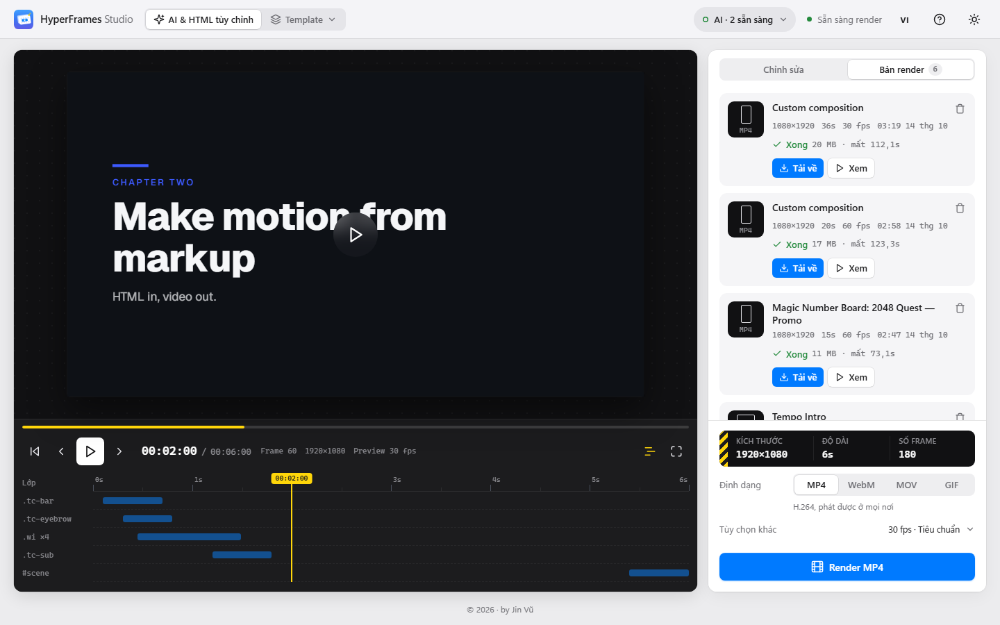

# HyperFrames Studio

[English](README.en.md)

Ứng dụng chạy trên máy để làm video motion ngắn bằng [HyperFrames](https://github.com/heygen-com/hyperframes).
Mô tả video để Claude hoặc Codex viết, hoặc import HTML và art của bạn. Xem preview có tiếng, kéo thanh thời gian, rồi
render MP4, WebM, MOV hoặc GIF ngay trên máy.

Chạy trên **Windows** và **macOS** (Linux chạy được từ terminal).



<table>
<tr>
<td></td>
<td></td>
<td></td>
</tr>
<tr>
<td align="center">Giao diện sáng</td>
<td align="center">Chọn template</td>
<td align="center">Bản render</td>
</tr>
</table>

## Cần cài

| | Windows | macOS |
|---|---|---|
| Node.js 22 trở lên | Bộ cài từ [nodejs.org](https://nodejs.org) | [nodejs.org](https://nodejs.org) hoặc `brew install node` |
| FFmpeg trong `PATH` | `winget install Gyan.FFmpeg` | `brew install ffmpeg` |
| AI để viết video (tùy chọn) | Claude CLI hoặc Codex CLI, hoặc Anthropic API key | như Windows |

Lần render đầu cần mạng: HyperFrames tải Chrome headless, và composition tải GSAP, Google Fonts từ CDN.

## Mở Studio

**Windows:** double-click **`HyperFrames Studio.cmd`**.

**macOS:** double-click **`HyperFrames Studio.command`**. Lần đầu macOS có thể chặn: chuột phải vào file, chọn
**Open**, rồi bấm **Open** lần nữa. Nếu báo file không chạy được, mở Terminal chạy một lần:

```bash
chmod +x "HyperFrames Studio.command"
```

Lần đầu sẽ cài thư viện và build giao diện (khoảng 1 phút). Các lần sau mở trong vài giây và tự mở
http://127.0.0.1:8787 trên trình duyệt. Giữ cửa sổ console/Terminal mở khi làm việc, đóng nó là tắt Studio. Sau khi
cập nhật code, mở lại launcher là Studio tự khởi động lại với bản mới.

Hoặc chạy từ terminal:

```bash
npm install
npm run dev        # API ở http://127.0.0.1:8787, giao diện hot reload ở http://localhost:5173
```

Kiểu production: `npm run build && npm start`, rồi mở http://127.0.0.1:8787.

## Lần đầu: kết nối Claude hoặc Codex

Lần đầu vào, Studio hiện bảng **Getting started** (mở lại bằng nút **?** trên thanh trên cùng). Bảng này cho biết
từng CLI đã cài và đã đăng nhập chưa, kèm lệnh để copy.

Chỉ cần một trong hai:

| | Cài | Đăng nhập |
|---|---|---|
| Claude CLI (gói Claude Pro / Max / Team) | `npm install -g @anthropic-ai/claude-code` | `claude auth login` |
| Codex CLI (gói ChatGPT) | `npm install -g @openai/codex` | `codex login` |

Cài hoặc đăng nhập xong, bấm **Check again** trong bảng hướng dẫn hoặc trong menu **AI connections**.

Không có gói nào? Chọn **API key** ở mục Model source và dán Anthropic API key. Key chỉ lưu trên máy ở
`server/data/config.json`, không gửi lên trình duyệt. Đặt biến môi trường `ANTHROPIC_API_KEY` cũng được.

## Làm video trong Studio

1. Bấm **Tạo AI** trên thanh công cụ bên trái.
2. Ở **Nguồn model**, chọn **Claude CLI** hoặc **Codex CLI**.
3. Mô tả video: nội dung chữ, không khí, màu sắc, chuyển động. Chọn khung hình (16:9, 9:16, 1:1) và độ dài.
4. Bấm **Tạo bằng Claude CLI** (hoặc Codex CLI). Thường mất 10–60 giây; Claude hiện tiến trình khi đang viết, Codex trả kết quả một lần ở cuối.
5. Xem preview. Bấm Play (hoặc Space) để nghe tiếng; nút loa ở thanh phát để chỉnh âm lượng.
6. Muốn đổi, chọn **Sửa bản này** rồi mô tả chỗ cần đổi; muốn sửa tay, mở **HTML** trên thanh công cụ.
7. Bấm **Xuất video** trên thanh trên cùng (Ctrl+E), chọn khung hình, định dạng, đoạn, rồi xuất. File xong nằm trong
   mục **Render**.

### Project và lịch sử phiên bản

Mỗi video là một project lưu trên máy (`server/data/library/`), tự lưu khi bạn sửa. Bấm tên project trên thanh trên
cùng để đổi tên, mở project khác, tạo mới, nhân bản hoặc xoá.

Mỗi kết quả AI, lần import, lần lấy từ template và lần lưu tay (Ctrl+S) là một phiên bản. Danh sách nằm dưới ô mô tả
trong **Tạo AI**, đầy đủ trong **Lịch sử**. Bấm nút so sánh để xem thử một bản trên preview (phím `\` đổi qua lại A/B
với bản đang dùng), hoặc khôi phục nó thành bản mới. Ctrl+Z / Ctrl+Shift+Z hoàn tác và làm lại mọi thay đổi trong
phiên làm việc.

### Xem trước và timeline

- **Lớp phủ vùng an toàn:** Title/action safe, khung giao diện TikTok, Reels, Shorts (Shift+S đổi nhanh).
- **Thu phóng:** Vừa khung, 50%, 100%, 200%.
- **Chụp PNG:** lưu frame đang xem ra ảnh (Shift+P).
- **Điểm vào/ra:** I và O đặt đoạn, X xoá, Shift+L lặp đoạn. Xuất video có thể chỉ xuất đoạn này.
- **Tốc độ xem:** 0.25×–2×; J/K/L tua lùi, dừng, tua tới (bấm thêm để nhanh hơn).
- **Marker:** M thêm marker tại playhead, `[` `]` nhảy marker, bấm đúp marker để xoá.

### Sửa HTML

Mục **HTML** là trình soạn thảo có tô màu, gập code, tìm/thay (Ctrl+F, Ctrl+H). Lỗi phổ biến hiện ngay tại dòng khi
gõ (thiếu root, audio phát chồng cùng track, `Math.random()`, …). **Kiểm tra composition** chạy bản kiểm tra đầy đủ
của HyperFrames và đánh dấu từng lỗi vào dòng tương ứng.

### Xuất nhiều bản cùng lúc

Trong **Xuất video**, chọn nhiều định dạng (MP4, WebM, MOV, GIF) và, với template, nhiều khung hình: mỗi khung được
template dựng lại bố cục chứ không cắt từ 16:9. Chọn **In–out** để chỉ xuất đoạn đã đánh dấu. Bật **Báo trên máy khi
render xong** để nhận thông báo hệ thống khi đang ở cửa sổ khác.

### Phím tắt

Ctrl+K mở bảng lệnh: gõ tên lệnh (không dấu cũng được) hoặc tên project. Bảng này liệt kê mọi phím tắt.

| Phím | Việc |
|---|---|
| Space · J K L | Phát/dừng · tua lùi, dừng, tua tới |
| ← → · Shift+← → | Lùi/tới 1 frame · 1 giây |
| I · O · X · Shift+L | Điểm vào · điểm ra · xoá đoạn · lặp đoạn |
| M · `[` `]` | Thêm marker · nhảy marker |
| Ctrl+Z · Ctrl+Shift+Z | Hoàn tác · làm lại |
| Ctrl+S · Ctrl+E · Ctrl+K | Lưu phiên bản · xuất video · bảng lệnh |
| Alt+1…6 | Mở Tạo AI, HTML, Template, Asset, Render, Lịch sử |
| Shift+S · Shift+P · F | Lớp phủ · chụp PNG · toàn màn hình |

### Dùng art và âm thanh riêng

Chuẩn bị một folder có `index.html` (file tạm cũng được) và các file của bạn, ví dụ:

```
my-promo/
  index.html
  img/logo.png
  sfx/whoosh.ogg
  music/bgm.ogg
  fonts/Brand.ttf
```

Kéo thả folder vào ô Import trong mục **Asset**, rồi tạo video ở mục **Tạo AI**. AI được báo danh sách file và dùng đúng đường dẫn. Nêu rõ các file
quan trọng trong prompt (“logo lấy từ img/logo.png, music/bgm.ogg âm lượng 0.4”). Âm thanh dùng thẻ
`<audio id src data-start data-duration data-track-index data-volume>`; các tiếng phát chồng nhau phải khác
`data-track-index`.

### Template

Các template có sẵn (title card, số đếm, …) nằm trong mục **Template** trên thanh công cụ. Chọn một template để sửa
trực tiếp các trường, hoặc bấm **Sửa dạng HTML** để lấy làm nền rồi sửa tự do.

## Điều khiển Studio từ terminal (MCP)

Studio cũng là một MCP server, nên phiên `claude` hoặc `codex` ở bất kỳ folder nào cũng làm video được qua nó.

1. Mở menu kết nối AI (chip **AI · … sẵn sàng**) trên thanh trên cùng (hoặc bước 3 của bảng hướng dẫn) và bấm **Add to Claude Code** hoặc
   **Add to Codex**. Thêm bằng tay:
   ```bash
   claude mcp add --scope user --transport http hyperframes-studio "http://127.0.0.1:8787/mcp?client=claude-cli"
   codex mcp add hyperframes-studio --url "http://127.0.0.1:8787/mcp?client=codex-cli"
   ```
2. Mở một phiên CLI **mới** và yêu cầu, ví dụ:
   > Use HyperFrames Studio to make a 6-second intro for my app, show it in the Studio, then render an MP4.

CLI có thể đọc hướng dẫn viết composition, điền template, xem từng frame, chạy kiểm tra, mở kết quả trong Studio (có
toast Undo) và render. Menu AI connections hiện trạng thái từng kết nối: Not connected, Ready to connect, Connected,
Calling, Running, và Rendering kèm tiến độ. Giữ Studio mở trong lúc CLI đang dùng. Phiên CLI đã mở từ trước cần khởi
động lại mới thấy Studio.

## Bố cục

Studio luôn vừa khít cửa sổ, không cuộn trang. Thanh công cụ bên trái chọn nội dung panel bên phải; preview, thanh phát
và timeline ở giữa. Kéo thanh mảnh bên trái panel phải để đổi độ rộng (double-click để về mặc định, dùng bàn phím thì
focus rồi bấm mũi tên). Trên điện thoại, thanh công cụ chuyển xuống đáy và timeline thu thành thanh tua.

## Xử lý lỗi thường gặp

- **“FFmpeg not found”**: cài FFmpeg (xem mục Cần cài), rồi mở lại launcher.
- **CLI báo Not installed / Not signed in**: chạy lệnh cài hoặc đăng nhập trong terminal, rồi bấm Check again. Trên
  macOS nếu CLI đã cài mà Studio không thấy, hãy mở Studio bằng file `.command` (file này nạp đường dẫn Homebrew và
  nvm) hoặc chạy từ Terminal nơi `claude --version` hoạt động.
- **“An older version of the studio is still running”**: đóng cửa sổ console/Terminal cũ (hoặc tắt `node` trong Task
  Manager / Activity Monitor), rồi mở lại launcher.
- **Trình tải (IDM)**: Studio tránh để IDM bắt nhầm. Link tải kết thúc bằng tên file thật, và âm thanh preview được
  tải bằng fetch thay vì thẻ media.

## Cách hoạt động

- `server/` (Express) dựng HTML composition từ template trong `server/src/templates` và render bằng cách gọi CLI
  `hyperframes` (phiên bản cố định). Tiến độ đọc từ dòng `@hf-progress` của CLI và đẩy lên giao diện qua SSE. Mỗi lần
  render một video, kết quả lưu ở `server/data/renders/<id>/`. File import nằm ở `server/data/projects/<id>/` và được
  chép cạnh HTML mỗi lần render.
- `web/` (Vue 3 + Vite) preview cùng HTML đó trong iframe. Một shim nhỏ tua `window.__timelines` và ẩn phần tử nằm
  ngoài khoảng `data-start`/`data-duration`, giống runtime của HyperFrames. Dope sheet dưới preview đọc từ timeline
  GSAP đang chạy. Thẻ `<audio>` được phát bằng Web Audio trong cửa sổ app, khớp với đầu phát.
- CLI chạy không có tool, trong một folder tạm trống. Đổi model bằng `HF_MODEL` (API), `HF_CLAUDE_MODEL` và
  `HF_CODEX_MODEL`.
- Server chỉ nghe `127.0.0.1` vì nó render mọi HTML được gửi tới; chỉ đặt `HOST` khi ở mạng tin cậy. Đây là app chạy
  trên máy theo thiết kế: render cần Chrome headless, FFmpeg và CLI đã đăng nhập, nên không chạy trên serverless như
  Cloudflare Workers.

## Thêm template

Tạo `server/src/templates/<name>.js` export `{ id, name, summary, duration, fields, build(values, ctx) }` và đăng ký
trong `server/src/templates/index.js`. `build` trả về `{ css, body, timeline }`; code timeline thêm tween vào `tl` đang
paused. Giữ tính xác định: không dùng `Math.random()`, `Date.now()` hay fetch.
